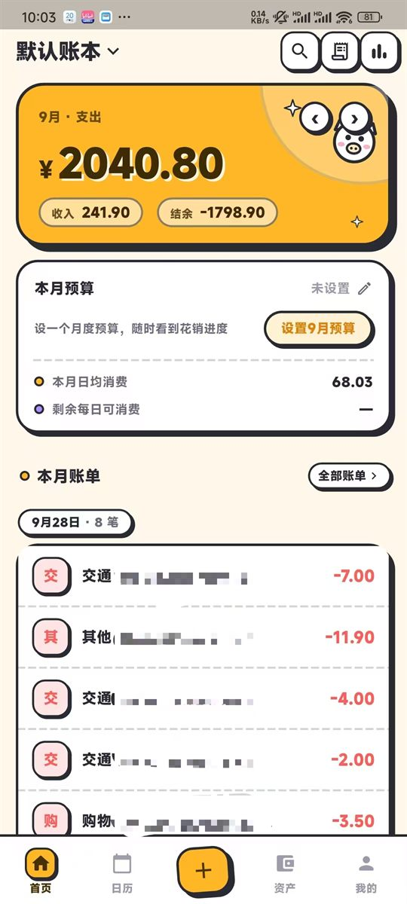
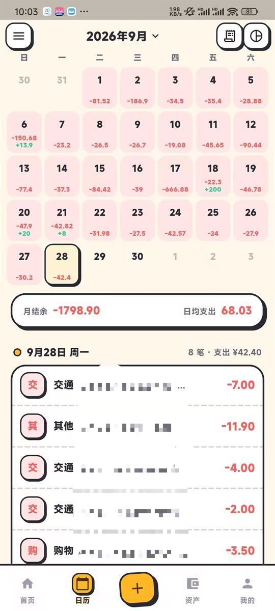
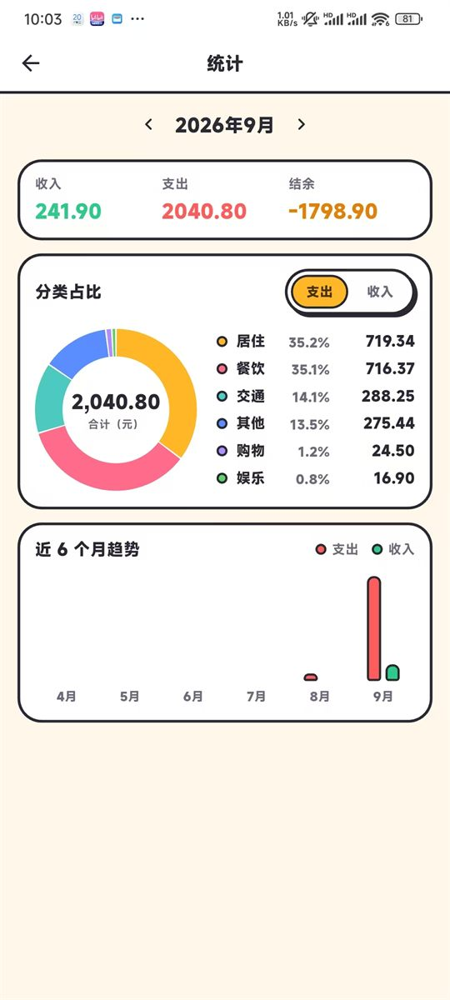

<div align="center">

# 颜芯记账

**把账本留在自己手机里的 Android 记账 App**

无账号 · 无服务器 · 无网络请求 · 无广告 · 无埋点

[](https://flutter.dev)
[](#)
[](#-数据边界)
[](#-质量门禁)

[**🌐 网页版介绍**](https://xander-299.github.io/yanxin-flutter/) ·
[**⬇ 下载 APK**](https://github.com/Xander-299/yanxin-flutter/releases/latest) ·
[**🚀 从源码构建**](#-从源码构建) ·
[**📖 文档索引**](#-文档索引)

<!-- 网页版 = docs/index.html（单文件、零外部依赖）。首次使用需在 Settings → Pages
     把 Source 设为「Deploy from a branch」→ master /docs。 -->

</div>

---

## 为什么值得看一眼

这是一个**完整版**的个人记账 App（16 个版本、约 1.96 万行 Dart），而不是一个 demo。它回答了两个具体问题：

1. **完全不联网的 App 能做到多完整？** 账单导入、自动记账、统计预算、数据导出全部在本地完成，没有一行代码发起网络请求。
2. **平台能力不可靠时怎么办？** 国产 ROM 上支付通知「不投递 / 只活 26 秒」，于是把自动记账做成三层采集 + 活性诊断，而不是假装一次回调就能成功。

---

## 📱 项目预览

实机截图（Redmi K50 · 卡通浅色主题）。粗描边与硬阴影都是代码画的，不引任何图片资源。

<table>
  <tr>
    <td align="center" width="33%">
      <br>
      <sub><b>首页</b><br>月度支出 hero · 预算卡 · 按天分组流水</sub>
    </td>
    <td align="center" width="33%">
      <br>
      <sub><b>日历</b><br>每日收支标注 · 长按记那一天 · 选中日账单</sub>
    </td>
    <td align="center" width="33%">
      <br>
      <sub><b>统计</b><br>分类占比圆环 · 近 6 月趋势（全部自绘）</sub>
    </td>
  </tr>
</table>

---

## 📲 快速体验

不用装开发环境，直接装 APK：

| 版本 | 适用设备 | 大小 | 下载 |
|---|---|---|---|
| **通用包**（推荐） | 绝大多数手机（arm64 / armv7 / x86_64 全含） | 64 MB | [下载][apk-universal] |
| **arm64 单独包** | 只想给现代 arm64 机（体积小 2/3） | 22 MB | [下载][apk-arm64] |

- 版本 **0.8.1**（截图记账 · F8.1；下面 Downloads 里的 APK 仍是上一次发布的 `v0.7.17`）
  · 最低 **Android 7.0** · 正式签名（`CN=yanxin`）· release 页见 [Releases][releases]
- 装好后首次会弹 7 页新手引导；卸载即彻底删除数据（无云端），想留档请先「我的 → 数据导出」

> ⚠️ 未上架任何应用商店。系统提示「未知来源」时，允许**当前这个文件管理器**安装即可。

[apk-universal]: https://github.com/Xander-299/yanxin-flutter/releases/download/v0.7.17/yanxin-v0.7.17-universal-release.apk
[apk-arm64]: https://github.com/Xander-299/yanxin-flutter/releases/download/v0.7.17/yanxin-v0.7.17-arm64-release.apk
[releases]: https://github.com/Xander-299/yanxin-flutter/releases

---

## 🧭 功能地图

<details open>
<summary><b>核心记账</b></summary>

| 模块 | 路由 | 做什么 |
|---|---|---|
| **首页流水** | `/` | 按天分组的流水列表、月份切换、月度收支 hero、**一行预算条**、**「记一笔 / 问一句」入口**；**左滑露出红色「删除」** |
| **记一笔** | `/record` | 自绘金额键盘 + 分类宫格 + 备注 + **日期 / 账户选择**；主按钮吸底常驻，随键盘上移 |
| **记一笔 / 问一句** | `/chat` | 一条聊天流：**打字问账本**（本月多少 / 某分类 / 预算还剩 / 为什么比上月多 / 大额支出，数字由账本算）+ **发账单截图**（端上 OCR → 待确认卡 → 确认才入账） |
| **搜索** | 浮层（不是路由） | 毛玻璃浮层；命中**分类名 / 账户名 / 备注 / 金额「元.分」文本**；支持「仅支出 / 仅收入 / 转账」类型指令 + 时间区间 + 命中高亮 + 搜索历史 |
| **日历** | `/calendar` | 月历标注（支出红 / 收入绿）、日汇总；**长按格子记这一天的账**、左右滑翻月 |
| **统计** | `/stats` | 分类占比圆环 + 近 6 月趋势柱，**自绘 `CustomPainter`，不引图表库** |
| **报表** | `/reports` | 三档切换：明细 / 分类汇总 / 账户汇总 |
| **预算** | 首页一行条 | 预算进度与**剩余每日可消费**、超支预警；点条开编辑弹层 |
| **资产** | `/assets` | 净资产卡 + 账户列表；账户增改删（**有流水的账户禁删**） |
| **设置** | `/settings` | 外观三选一：**浅色 / 深色 / 跟随系统（默认）**，选择落 `schema_meta` KV，冷启动沿用 |

</details>

<details open>
<summary><b>数据进出</b></summary>

| 模块 | 做什么 |
|---|---|
| **账单导入** | 微信（旧版 CSV / 2025+ xlsx）、支付宝（旧版 CSV / 新版 GBK 回单）；**解析五层** + 指纹幂等入账 + 试算报告 + 单条勾选 |
| **数据导出** | 流水 CSV + 完整备份 JSON；走 **SAF 系统文件选择器**（免存储权限） |
| **账本 / 分类 / 账户** | 多账本切换与管理、分类增删改、账户图标与颜色 |

</details>

<details open>
<summary><b>自动记账（可选）</b></summary>

| 模块 | 做什么 |
|---|---|
| **通知监听自动入账** | 监听微信 / 支付宝支付通知 → 解析金额方向 → 静默入账 → 发「已自动记账 N 笔」回执（可**一键撤销**）；三层采集 + 活性诊断页 |
| **分享记账** | 零权限兜底：在微信 / 支付宝里「分享」账单文本到本 App → 同样自动入账 |

</details>

---

## 🔔 自动记账：当平台能力不可靠时

```
系统绑定 NotificationListenerService
  → Kotlin 只做「包名过滤 + 取文案 + 落盘 JSONL」（不解析、不碰库）
  → Dart drain() → 纯函数解析（金额 / 方向 / 商户）→ importRows()（drift 唯一 DB writer）
  → 记批次 → 首页提示条 + 「已自动记账 N 笔」回执通知（可一键撤销）
```

**三层采集**（支付通知在国产 ROM 上极不可靠）：

| 层 | 通道 | 触发 | 实测（Redmi K50） |
|---|---|---|---|
| 1 | `onNotificationPosted` | 通知发布 | ⚠️ 该机型**完全不投递** → 降级为可选加速 |
| 2 | `AutoBookGuard` 补抓守护 | `AlarmManager` 60s 周期 + 醒来续期 | ✅ 每 ~53 秒准点 |
| 3 | `onNotificationRemoved` | 通知被撤回那一刻 | ✅ 实测**独立救回过 1 笔** |

三层**共用同一条判定链 + 持久指纹集** → 同一笔不会记两遍。

> **为什么需要第 3 层**：支付通知**只活 26 秒**（点进「支付成功」页微信就 `cancel()`），
> 撤回后连 `getActiveNotifications()` 都捞不到 → 撤回那一刻是**唯一**的救援窗口
> （Android 保证此时 `extras` 仍完整，只丢 `contentView` / `largeIcon`）。

**诊断**：「我的 → 自动记账」有诊断页，逐层显示「服务有没有绑上 / 最近捕获 / 待入账 / 上次检查结果」，
出问题先看它，能直接定位是哪一层断了。

---

## 🏗 项目结构

```
lib/
├── app.dart                     路由表（go_router：壳路由 + 全屏页）
├── main.dart                    入口（ProviderScope + drift 初始化）
├── core/                        基础设施（不依赖任何 feature / data）
│   ├── db/                      drift：tables / database / schema_v1 / schema_v2
│   ├── providers/               data_epoch（写操作后的统一失效信号）
│   ├── theme/                   tokens.dart（设计令牌）+ toon/（卡通通用件，按组件分文件）
│   ├── utils/                   money / id / fingerprint / date / highlight
│   └── constants/               preset.dart（预置分类、账户类型、默认账本名）
├── data/
│   ├── providers/               数据层 DI：database + book / account / category 等 provider
│   └── repositories/            6 个仓储：book / account / category / transaction / budget / app_meta
└── features/                    按业务垂直切分：application（逻辑）+ presentation（UI）
    ├── nav/ ledger/ record/ calendar/ stats/ reports/ search/ assets/
    ├── import/ export/ autobook/ onboarding/ book/ category/ profile/ shared/

android/app/src/main/kotlin/com/teacodeman/yanxin/
├── MainActivity.kt              MethodChannel 接线
└── autobook/                    自动记账原生侧（7 文件，只落盘不解析）

tool/    开发工具链（门禁等效 / APK 核验 / 发布 / 设备调试），见 tool/README.md
test/    52 个测试文件，目录与 lib/ 结构镜像
docs/    spec/（签字的 SPEC）· dev/（走查与环境手册）· handoff/（交接档案）· design/（原型图）
```

**分层约定**

```
presentation（UI）→ application（Controller / 纯函数）→ data（仓储 / 规则）→ core（基础设施）
```

- **drift 是唯一 DB writer** —— Kotlin 侧只落盘，不碰数据库。
- **纯函数优先** —— 解析规则、金额计算、命中口径、聚合统计全部无副作用，`test()` 直接覆盖。
- **常驻 provider 必须 `ref.watch(dataEpochProvider)`** —— 否则「刚记一笔后搜索搜不到」这类过期快照 bug 会回来。
- **纯 UI 的模块可以只有 `presentation/`** —— `book` / `category` / `profile` / `nav` 的状态在
  `lib/data/providers/` 或对应 controller 里，这是有意为之的例外，不是漏了 `application/`。

---

## 🔧 技术选型

| 关注点 | 选型 | 理由 |
|---|---|---|
| 数据库 | **drift 2.31.0** + sqlite3 2.9.4 | 编译期参数绑定（根治旧栈手写 SQL 拼接）；零迁移演进到 schema v3 |
| 状态管理 | **Riverpod 3** | 常驻 provider + `dataEpoch` 版本号，替代逐个手工 refresh |
| 路由 | **go_router 18** | `StatefulShellRoute` 壳路由（底栏 4 tab 各自保留页面栈） |
| 金额 | **`int` 分** | 全程整数，**禁止浮点** |
| 主键 | UUID v4 | 客户端发号，离线可用 |
| 入账指纹 | `crypto` SHA-1 | 纯 Dart，无 native 钩子 |
| 文件选择 | `file_picker` | Android SAF，免存储权限 |
| xlsx 读取 | `archive` + 手写正则 | **不用 `excel` 包**：数值过 double 会丢 31 位单号精度 |
| CSV / GBK | 自研逐字符状态机 + `gbk_codec` | 无成熟纯 Dart 方案；回环校验判坏件 |
| 自动记账 | **Kotlin 原生**（`NotificationListenerService` + `MethodChannel`） | **零新增 pub 依赖**；Dart 侧只做纯函数解析 |

---

## 🚀 从源码构建

**环境**：Flutter 3.47.2（Dart 3.13.2）· JDK 17 · Android SDK（platform 36 + build-tools 36）· Git。

```bash
git clone git@github.com:Xander-299/yanxin-flutter.git
cd yanxin-flutter

cp env.example.sh env.sh     # 按本机填 SDK 路径（env.sh 不入库）
source env.sh

flutter pub get
dart run build_runner build --delete-conflicting-outputs   # 改表结构后必须重跑

flutter test && flutter analyze                            # 门禁（与 CI 同一套）
flutter build apk --release --target-platform android-arm,android-arm64,android-x64
```

> ⚠️ **依赖版本锁死，别随手升级**：`drift 2.31.0` / `sqlite3 2.9.4` / `build_runner 2.15.1`。
> sqlite3 3.x 起带 native-assets 构建钩子（Windows 需 MSVC），build_runner 2.16+ 要求 analyzer ≥13 与 `drift_dev` 冲突。

> ⚠️ **签名**：`android/key.properties`（不入库）四键齐全时用正式签名，缺失时回退 debug 签名 ——
> 所以 clone 下来的机器也能出包。装机前用 `aapt dump badging <apk> | head -1` 确认 versionCode。

### 开启自动记账（可选）

手动记账开箱即用。要自动从支付通知入账，需授予「通知使用权」：

| 品牌 | 路径 |
|---|---|
| 小米 / Redmi | 设置 → 通知与控制中心 → 通知使用权 → 找到「颜芯记账」→ 打开 |
| 华为 / 荣耀 | 设置 → 应用和功能 → 应用管理 → 颜芯记账 → 通知使用权 → 打开 |
| OPPO / vivo | 设置 → 通知管理 → 通知使用权（各机型叫法略有差异） |

再允许「发通知」（Android 13+ 需运行时授权），然后去付一笔钱并**打开一次本 App** 验证。

> ⚠️ **国产 ROM 必读**：强行停止或覆盖安装后，系统会**自动解绑**通知监听服务（设置里仍显示「已开启」）。
> 遇到不生效，把通知使用权**关掉再打开一次**即可恢复。

---

## 📊 项目规模

| 维度 | 数据 |
|---|---|
| 代码量 | Dart **138 个源文件 / 26,660 行**（含 `part`）· Kotlin **9 个文件 / 1,689 行** |
| 测试 | **63 个测试文件** · 574 处 `test()` / `testWidgets()`（实跑 588 passed / 6 skipped） |
| 迭代 | **157 次提交** · **18 个版本 tag**（`v0.7.1` – `v0.7.17`、`v0.8.1`） |
| 验证环境 | MuMu 模拟器 + **Redmi K50 真机**（MIUI/HyperOS，adb 全包走查） |

> 数字取自仓库本身（`git rev-list --count HEAD`、文件行数统计），可复算。

---

## 🔒 数据边界

- **无网络权限**（release 包）：`AndroidManifest` 里没有 `INTERNET`，不存在「说好不联网但偷偷传」的余地。
  > debug 包会带 `INTERNET`（Flutter 热重载需要），核对权限时别把这条当成矛盾。
- **无账号体系**：没有登录、没有云端 ID，数据只在应用私有目录的 `yanxin.sqlite`。
- **可导出**：流水 CSV + 完整备份 JSON，随时可带走。

---

## ✅ 质量门禁

每次 push 自动跑（[`.github/workflows/ci.yml`](.github/workflows/ci.yml)）：

```
flutter pub get → build_runner → 生成物新鲜度检查 → flutter analyze → flutter test
```

**生成物新鲜度**是一条硬检查：`database.g.dart` 是入库的生成物，改了 `tables.dart` 却忘了重跑
`build_runner`，编译期不会报错、运行时才会出问题 —— 这条检查把它变成红灯。

---

## 📚 文档索引

| 文档 | 内容 |
|---|---|
| [`HANDOFF.md`](HANDOFF.md) | **接手入口**：现状、必须守住的不变量、目录导航 |
| [`CHANGELOG.md`](CHANGELOG.md) | 版本变更记录 + tag 表 |
| [`docs/RESUME.md`](docs/RESUME.md) | 简历向项目介绍（规模 / 技术难点 / 迭代记录 / 为什么要重写） |
| [`docs/PRD-yanxin-flutter.md`](docs/PRD-yanxin-flutter.md) | 功能需求汇总（FR 编号 + 状态） |
| [`docs/spec/`](docs/spec/) | 各阶段签字的 SPEC（总 SPEC + F7.3–F7.15） |
| [`docs/dev/`](docs/dev/) | 真机走查手册、Windows 环境重建 |
| [`docs/handoff/`](docs/handoff/) | 交接档案（事实 / 坑 / 未解决 / 历史 / 逐轮记录） |
| [`docs/acceptance-*.md`](docs/) | 各阶段真机走查验收报告 |
| [`docs/design/`](docs/design/) | 页面原型参考图（**历史深色版**，见该目录 README） |
| [`tool/README.md`](tool/README.md) | `tool/` 下每个脚本的用途与适用条件 |
| [`tasks/todo-flutter.md`](tasks/todo-flutter.md) | 迁移任务清单 |

---

## 📄 License

仅供学习与个人使用（All rights reserved）。转载或商用请先联系作者。
